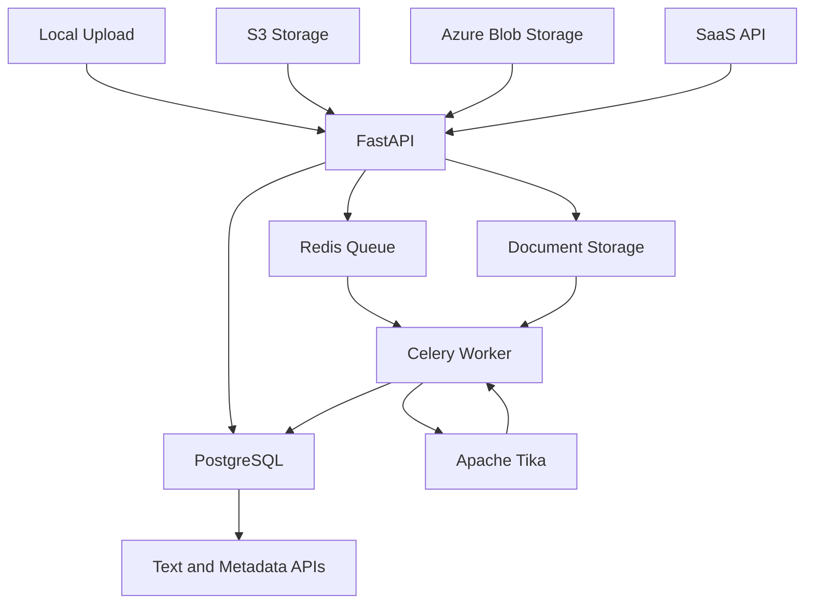
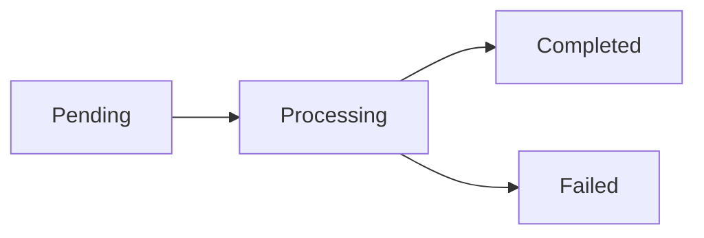

# Cloud Document Processing Engine

An asynchronous document processing engine that ingests
documents from local uploads, cloud storage and SaaS APIs,
extracts text and metadata, and stores processed results
in a PostgreSQL database.

## Features

- Multi-source document ingestion
- AWS S3-compatible storage integration
- Azure Blob Storage integration
- SaaS API integration
- Multi-format document processing
- Text and metadata extraction using Apache Tika
- Asynchronous processing using Celery and Redis
- Document status tracking
- Source tracking
- File validation and size restrictions
- REST APIs with interactive Swagger documentation
- Docker Compose infrastructure
- Automated API and integration testing

## Technology Stack

| Technology | Purpose |
|---|---|
| Python | Backend development |
| FastAPI | REST API framework |
| PostgreSQL | Persistent document storage |
| SQLAlchemy | Database ORM |
| Apache Tika | Text and metadata extraction |
| Redis | Message broker and task results |
| Celery | Asynchronous task processing |
| Boto3 | S3 integration |
| Azure Storage SDK | Azure Blob integration |
| HTTPX | SaaS API communication |
| SeaweedFS | Local S3-compatible storage |
| Azurite | Local Azure storage emulator |
| Docker Compose | Infrastructure orchestration |
| Pytest | Automated testing |

## System Architecture



## Processing Workflow

1. Ingest documents from supported sources.
2. Validate filenames, file extensions and file sizes.
3. Store documents in local storage.
4. Create document records in PostgreSQL.
5. Submit asynchronous processing tasks to Redis.
6. Process documents using Celery workers.
7. Extract text and metadata using Apache Tika.
8. Update document status and store extracted results.
9. Retrieve processed information through REST APIs.

Local uploads support manual processing requests.
Cloud and SaaS imports automatically submit background tasks.

## Supported File Extensions

- PDF
- DOC and DOCX
- TXT
- XLS and XLSX
- PPT and PPTX
- CSV

Maximum supported file size: 50 MiB.

PDF, DOCX and TXT extraction have been verified.

## API Endpoints

| Method | Endpoint | Description |
|---|---|---|
| GET | / | Application information |
| GET | /health | Basic health endpoint |
| POST | /documents/upload | Upload document |
| GET | /documents/ | List documents |
| GET | /documents/{document_id} | Retrieve document |
| GET | /documents/{document_id}/text | Retrieve extracted text |
| GET | /documents/{document_id}/metadata | Retrieve metadata |
| POST | /documents/{document_id}/process | Synchronous processing |
| POST | /documents/{document_id}/process-async | Asynchronous processing |
| GET | /documents/tasks/{task_id}/status | Track background task |
| POST | /s3/import | Import S3 document |
| POST | /azure/import | Import Azure document |
| POST | /saas/import | Import SaaS document |

## Prerequisites

- Python 3.11
- Docker Desktop
- Docker Compose
- Git

## Installation

Create a Python virtual environment:

```bash
python -m venv venv
```

Activate the virtual environment on Windows:

```powershell
.\venv\Scripts\Activate.ps1
```

Install dependencies:

```bash
python -m pip install -r requirements.txt
```

Start infrastructure services:

```bash
docker compose up -d
```

Check container status:

```bash
docker compose ps
```

## Running the Application

Start FastAPI:

```bash
python -m uvicorn app.main:app --reload
```

Start the Celery worker in a separate terminal:

```bash
python -m celery -A app.tasks.document_tasks worker --loglevel=info --pool=solo
```

Start the mock SaaS server in another terminal:

```bash
python -m uvicorn scripts.mock_saas_server:app --port 8001
```

Open Swagger UI:

http://127.0.0.1:8000/docs

## Document Status Lifecycle



## Testing

Run API tests:

```bash
python -m pytest tests/unit/ -v
```

Run integration tests:

```bash
python -m pytest tests/integration/ -v
```

Run the complete test suite:

```bash
python -m pytest tests/ -v
```

### Verified Test Results

| Test category | Passed |
|---|---|
| API tests | 9 |
| End-to-end integration tests | 1 |
| Total | 10 |
| Failed | 0 |

The integration test verifies local document upload,
database storage, asynchronous task processing,
text extraction and metadata extraction.

## Security and Validation

- Filename validation
- File extension allowlisting
- File size restrictions
- Empty file rejection
- Unique document storage directories
- Restricted SaaS download URLs
- Localhost-bound infrastructure ports

## Development Scope and Limitations

- S3 integration is tested using SeaweedFS.
- Azure integration is tested using Azurite.
- SaaS integration uses a local mock API.
- No paid cloud account is required.
- Docker Compose manages infrastructure services.
- FastAPI and Celery run in the local Python environment.
- Authentication and malware scanning are not implemented.
- Automated cloud ingestion tests remain future work.
- Integration tests currently retain generated test data.

## Future Enhancements

- OCR support for scanned documents
- NLP-based document classification
- LLM-powered structured information extraction
- Schema-driven document intelligence
- Authentication and authorization
- Automated cloud integration testing
- Production cloud deployment
- Monitoring and observability

## Author

Adweta Mishra
